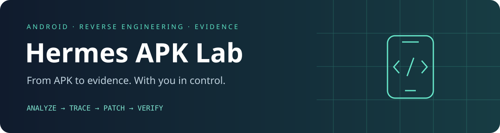
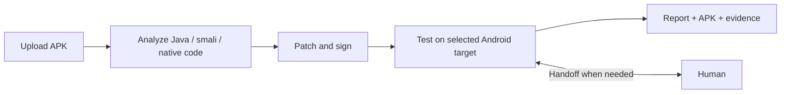

<p align="center"></p>

# Hermes APK Lab

**An Android reverse-engineering workspace for Hermes Agent: upload, investigate,
patch and verify — with explicit human handoffs when you need them.**

[Installation](INSTALL.md) · [Configuration](docs/CONFIGURATION.md) ·
[Architecture](docs/ARCHITECTURE.md) · [Examples](docs/EXAMPLES.md) ·
[Validation](VALIDATION.md) · [Contributing](CONTRIBUTING.md)

> [!IMPORTANT]
> **LAWFUL USE ONLY — YOU ARE RESPONSIBLE FOR HOW YOU USE THIS TOOL.**
>
> **Only analyze, test or modify applications when you have the necessary rights
> or explicit authorization for the intended work. Understand your purpose,
> the permitted scope and the consequences before you begin.**
>
> **Follow applicable law, contracts, privacy requirements and rules governing
> modification and redistribution. Possessing an APK, calling an activity
> "research" or using it for education does not by itself grant permission.
> Authorization for one app does not extend to unrelated accounts, devices,
> services or data. If your authority or scope is unclear, resolve it first.**
>
> **This project does not grant permission to perform unauthorized activities.
> This notice is not legal advice and does not make unlawful use lawful.**

## Tested configuration

The implementation has been exercised on the following host. This records the
validated environment, not minimum hardware requirements or certification of every OS.

| Component | Validated configuration |
| --- | --- |
| OS / architecture | Ubuntu 24.04.5 LTS, Linux x86_64 |
| Kernel | 7.0.0-38-generic |
| CPU / memory | Intel Core i9-14900KF, approximately 62 GiB usable RAM |
| Python / Java | Python 3.13.2, OpenJDK 21.0.12.1 |
| APK tools | JADX 1.5.6, Apktool 3.0.3, Android SDK Build Tools 37.0.0 |
| Native analysis | Ghidra 11.4.2; synthetic C++ x86_64 ELF |
| Android runtime | API 34 Google APIs x86_64 managed AVD, usable KVM |

**Verified:** synthetic APK decode/build/sign/re-decode, native decompilation and
project reuse, emulator installation and before/after UI scenarios, diagnostic
log markers, turn ownership and resumable transfers. See [recorded validation](VALIDATION.md).
The fresh SDK installer selects Build Tools 36.0.0; that fresh-install path has
unit coverage but was not exercised on a clean OS. WSL2, physical phones, live
Android Frida hooks, external internet access and the complete Telegram/model
conversation have not been validated end to end.

## Why this project

- **Large APKs:** resumable browser uploads, 4 GiB default limit, direct hosting.
- **Evidence-backed investigation:** manifest reconnaissance, exact smali references,
  selected native pseudocode and persistent notes.
- **Human control:** automatic, assisted or manual work, independent of device choice.
- **Verifiable changes:** versioned signed builds, scenario evidence and original PNGs.
- **Continuity:** saved jobs, explicit next actions, demonstrated procedures and symbol aliases.
- **English and Russian:** natural-language requests and responses in the user's language.



## Start with a request

> Analyze this APK. Explain where the setting is stored and what resets it after
> restart. Work in assisted mode on my phone. If you cannot reach the screen,
> hand control to me and continue from the current state when I say ready.

Hermes provides a complete upload link, preserves the investigation in its workspace,
and records whether the final behavior was verified, failed or left untested.
More [example workflows](docs/EXAMPLES.md) show native analysis and diagnostic logging.


A local laboratory for analyzing, patching and visually testing Android applications
through Hermes Agent and Telegram. Docker is not used.

The project contains the controller, web interface, skill and decompilers. Uploaded
APKs, decompilation, investigations, patches, builds and screenshots live **in the
Hermes workspace**: `<terminal.cwd>/apk-lab/projects/<job_id>/`.

## Installation and binding

For a fresh machine, follow [INSTALL.md](INSTALL.md), including system packages,
Hermes configuration and SDK bootstrap. It also describes WSL2 restrictions.
The short sequence below assumes the documented system dependencies and Hermes
configuration are already present.

Requirements: Linux, Python 3.11+, Java 21, Hermes with a local terminal,
Android SDK Build Tools and platform-tools. The server is directly accessible
without third-party tunnels. Java and the SDK are installed on the host; JADX,
Apktool and Ghidra (installed via `python3 scripts/setup_native.py`) live in `toolchain/`.

```bash
cd ~/project/hermes-apk-lab
python3 scripts/configure.py
python3 scripts/setup_tools.py
python3 scripts/setup_sdk.py --licenses
python3 scripts/install.py --replace-existing
./bin/apk-lab doctor
```

The installer reads `~/.hermes/config.yaml`, uses `terminal.cwd`, links the skill
at `~/.hermes/skills/security/apk-reverse-engineering`, creates `~/.local/bin/apk-lab`
and adds instructions to the workspace AGENTS.md. Other Hermes settings are
preserved. PyYAML is required to validate Hermes configuration even when
`--workspace` is explicit. For another profile use
`--hermes-home` and that profile's workspace.

An existing skill with the same name is replaced only with `--replace-existing`;
its backup is kept outside skill discovery in `~/.hermes/apk-lab-backups/`.
Changes to the source skill in this project are immediately available through the link.

The current Hermes version discovers new skills automatically. If an existing
conversation retains the old skill text, load the skill explicitly or start a
new conversation. The installer does not force a gateway restart.

## What to write in Telegram

“Analyze an APK: determine how synchronization works. Give me an upload link.”

“Change the initial value of a setting in this app. Test on the connected phone
and show screenshots before and after.”

“Test the patch in virtual Android and show screenshots before and after.”

If no testing method is specified, Hermes asks: “Where should the app be tested:
on the connected phone, in virtual Android, or without testing?” The choice is
saved for the job. With “without testing”, the build is published with an explicit
notice that application behavior has not been tested.

“Explore the app interface on the phone and describe user scenarios.”

“Resume job ...”, “Give me the result link again”, “Stop the web server.”

Explicit invocation: `/apk-reverse-engineering <task>`.

English and Russian requests are equally supported. The skill interprets natural
Russian descriptions, mode choices and handoff signals, and replies/reports in
the user's language unless another language is requested. CLI identifiers remain
English; users do not need to translate their requests into CLI syntax.

Hermes starts reception, sends the link and backgrounds `wait-upload` with
`notify_on_complete=true`. After upload, Hermes receives a notification in the
original conversation and continues investigating. The background process does
not invoke another model; the current session model is used. After a gateway
restart or loss of the background waiter, resume by job ID: data and the next
step remain on disk. A complete link is `http://ADDRESS:9099/#job=ID&token=KEY`.
Host and port without `#job=...&token=...` open only the general page and cannot
access the job. `--format telegram` prints a short response with the full link;
Hermes copies it in full. Reissuing a link rotates it and invalidates the old one.

## Automatic, assisted and manual work

Working mode is independent of device choice. Hermes must offer both choices:
**phone / emulator / no runtime** and **automatic / assisted / manual**.

| Mode | Behavior |
| --- | --- |
| Automatic (`auto`) | The agent explores the UI and tests the scenario itself; on a blocker it stops pointless retries and offers help |
| Assisted (`assisted`) | Performs accessible steps itself; after two failed attempts at the same transition, or when the route is unclear, asks the user to complete a specific segment |
| Manual (`manual`) | The user reaches a stage and says “ready”; the agent investigates the current state and hands control back |

Example Telegram request:

> Work in assisted mode on the phone. If you cannot reach the required screen,
> hand control to me. After I say “ready”, inspect the UI and logs as they are,
> without restarting the application.

```bash
apk-lab work-mode JOB assisted
apk-lab handoff JOB user --note 'Open the hidden tab and stop before sending'
# After an actual user message saying “ready”:
apk-lab handoff JOB agent --note 'The user opened the tab; inspect the current state'
apk-lab observe JOB --label user-ready
```

Turn ownership is saved in job state and history. During the user's turn,
`device action` and `install-test` are blocked; reading the screen/logs is allowed.
`observe` captures the current screen, UI hierarchy and recent logcat, preserving
errors from individual sources. It neither installs nor launches the app.
This is a snapshot, not a continuous recording of all user actions.

The emulator stays running during a handoff. For manual interaction choose
`test-target JOB emulator --window`: the window opens on the **Hermes host's
 desktop**, if a graphical session is available. Telegram users need access to that
desktop or a separate viewer. The APK upload page does not stream Android.
An already-running headless emulator is not restarted just to show a window;
use local scrcpy if installed, or select windowed mode beforehand.

## Demonstration memory and readable names

After a difficult route is demonstrated, the agent saves steps, conditions,
result and evidence via `remember JOB FILE.json`. `knowledge JOB` retrieves
experience for the same APK SHA-256, considering build/device context and
evidence-file integrity.

Experience accumulates in files without training model weights. The agent may
offer to reproduce the learned route. In manual mode it waits for permission;
after failure it records that failure and asks for help again. A successful
demonstration and successful independent reproduction are recorded separately.
A new APK version requires revalidation.

For obfuscated code, pairs of `original method/address -> readable name` are
stored. UI, resources, logs, JNI, strings and data-flow tracing provide the basis.
Each name is marked as surviving, inferred or observation-confirmed. Original
descriptors/addresses remain available; smali references are not arbitrarily
renamed. Record formats and the handoff process are in
[collaboration.md](skills/apk-reverse-engineering/references/collaboration.md).

## C/C++ and diagnostic logs

A separate command handles native `.so` libraries:

```bash
python3 scripts/setup_native.py
apk-lab native JOB lib/arm64-v8a/libexample.so
apk-lab native JOB lib/arm64-v8a/libexample.so --decompile --function JNI_OnLoad --limit 5
```

It performs ELF analysis, symbol/string extraction and selected-function
decompilation through Ghidra. Addresses, pseudocode, references and the Ghidra
project are saved for continuation. All research remains in the Hermes workspace.
The output is C-like pseudocode; the original C++ project and stripped names are
not automatically recovered. Machine-code analysis does not imply universal C++
rebuilding from pseudocode. See [native.md](skills/apk-reverse-engineering/references/native.md).

Reversible smali markers help investigate behavior:

```bash
apk-lab build JOB --baseline
apk-lab instrument JOB --method 'La/b;->c()V' --label refreshSettings --at entry
apk-lab build JOB
# Install the diagnostic build, replay the scenario, read APKLAB in logcat.
apk-lab uninstrument JOB MARKER_ID
# Build and test the final version without temporary markers.
```

Markers can target entry, returns or an exact line with source-hash verification.
A marked build is diagnostic and cannot pass `finish --kind patch` as final.
Markers demonstrate execution of a site; editable Java/native Frida templates and
hook-selection guidance cover arguments, decoded strings and request contents.
Frida requires separate environment preparation and is not automatically installed
on the phone. These templates have not been tested in a live Android Frida session.
See [instrumentation.md](skills/apk-reverse-engineering/references/instrumentation.md).

## Large file transfer

- The server listens on **`0.0.0.0:9099`** by default: all host IPv4 interfaces.
  Hosting is direct, without third-party tunnels or Docker.
- Open `http://HOST_ADDRESS:9099`, not `0.0.0.0`. Without an external address
  configured, the controller uses a host interface address, usually LAN.
- For internet access, set `public_base_url`, e.g. `http://YOUR_DOMAIN:9099`, in
  `config.local.json` or rerun
  `python3 scripts/install.py --public-base-url http://YOUR_DOMAIN:9099`.
  The installer preserves the workspace and other settings. After changing the
  address, stop the server; the next `link JOB` starts it again.
- Inbound TCP 9099 must reach the Hermes computer. Behind a router, forward the
  external port to this computer and allow it through the firewall. Behind CGNAT,
  obtain a public address from the ISP. Binding to `0.0.0.0` does not change
  NAT/firewall rules. Router configuration is not automated.
- The direct server uses HTTP: tokens restrict access but do not encrypt traffic.
  For HTTPS, a self-hosted reverse proxy can be used; external services are not
  required. `public_base_url` changes links, not server TLS support.
- Default APK limit: 4 GiB; browser chunks: 8 MiB.
- After interruption, select the same file again. Received chunks are preserved;
  input reaches analysis only after complete reception and SHA-256 verification.
- The temporary token arrives in the URL fragment. The API checks it; result
  downloads use an HttpOnly cookie.
- Shutdown occurs after 30 minutes without transfers or a 4-hour server lifetime;
  active transfers finish before automatic shutdown. An open status tab does not
  keep the server alive indefinitely.
- `apk-lab server stop` stops the server without deleting jobs.
- Manual start: `apk-lab server start --exposure direct --port 9099`.
  Loopback-only debugging: `--exposure local`. `lan` is a compatibility alias for
  binding to all interfaces.

Settings live in `config.local.json`; logs are in
`<workspace>/apk-lab/.runtime/server.log`. The server starts on demand separately
from Hermes. Jobs, APKs, reports and screenshots survive shutdown.

## Phone and multimodal testing

A managed Android Emulator (API 34, x86_64) supports testing without a phone.
Install its official SDK components and create the AVD once:

```bash
cd ~/project/hermes-apk-lab
python3 scripts/setup_emulator.py
apk-lab emulator status
```

KVM and approximately 10 GiB free space are required. The Android image and
Emulator binary live in the installed SDK; virtual-device data lives in
`<terminal.cwd>/apk-lab/.emulator/avd`. By default it runs without a graphical
window; Hermes sees it through ADB screenshots and `vision_analyze`. Select
`apk-lab test-target JOB emulator`; after testing, finish with
`apk-lab finish JOB --report ...`: the controller automatically stops the emulator
when its last job completes. For interrupted jobs use `apk-lab emulator stop`.
If an app requires another architecture, Play Store, physical sensors or hardware
attestation, the emulator does not replace a phone.

1. Enable Developer options and USB debugging on the phone.
2. Connect it to the Hermes host and accept the phone's RSA prompt.
3. `apk-lab device list` shows the serial; Hermes selects it for the job through
   `test-target JOB phone --serial SERIAL`.
4. For Android Wireless debugging, first run `adb pair IP:PAIR_PORT` locally with
   the code on the phone, then `apk-lab device connect IP:CONNECT_PORT`.
   This is a separate connection; APK upload port 9099 is not used for ADB.

Agent loop: screenshot -> `vision_analyze` -> action -> new screenshot. Hermes'
built-in vision tool passes the image to the multimodal model. Available operations
include tap/swipe/key/text/launch, UI hierarchy, logcat and install-test. Coordinates
use original screenshot pixels, accounting for scaling and rotation.

Screenshots retain device, size, time and build metadata and are automatically
published in the job. The results page previews them and offers original-quality
PNG downloads. `device evidence` binds before/after screenshots to an exact build
SHA-256, expectation, observation and verdict. Nonvisual effects need additional
logs/traces. Screenshots and logs may contain app data; publish only task-relevant material.

Tools do not uninstall apps, clear data, root devices or bypass USB confirmation.
A signature mismatch during `adb install -r` is an explicit blocker to resolve
with the phone owner.

## Main commands

```bash
apk-lab open --goal 'Investigate the required behavior' --format telegram
apk-lab list
apk-lab status JOB
apk-lab wait-upload JOB
apk-lab inspect JOB
apk-lab decompile JOB
apk-lab recon JOB
apk-lab xrefs JOB 'Lpkg/State;->enabled:Z'
apk-lab xrefs JOB 'Lpkg/Settings;->refresh()V'
apk-lab checkpoint JOB --next 'Check the screen handler'
apk-lab build JOB --baseline
# After editing decoded/apktool and writing patches/CHANGELOG.md:
apk-lab build JOB
apk-lab work-mode JOB assisted
apk-lab test-target JOB phone --serial SERIAL
# Or: apk-lab test-target JOB emulator
# Or: apk-lab test-target JOB none
apk-lab device screenshot JOB --label before
apk-lab device install-test JOB /absolute/builds/r002/patched.apk
apk-lab device screenshot JOB --label after --build-sha256 SHA256
apk-lab device evidence JOB /absolute/tests/scenario.json
apk-lab finish JOB --report /absolute/analysis/REPORT.md --kind patch
apk-lab link JOB --format telegram
apk-lab server stop
```

Replace JOB/paths with actual values. Commands return JSON by default;
`open/link --format telegram` return text with a full link. Errors have nonzero
exit codes. `pause JOB` stops managed long-running commands; `resume JOB` returns
the job to continuation using saved files.

## Investigation process

Hermes starts with acceptance criteria: what behavior must be explained/changed
and what observation will confirm it. It maps component -> screen/handler -> state
-> storage, network or JNI. Facts, hypotheses and unknowns are recorded separately;
conclusions cite code/observations. Hypotheses include alternatives and a test.

Two commands help make analysis reproducible:

| Command | Output |
| --- | --- |
| `recon JOB` | `analysis/recon.json`: components/intent filters/permissions, manifest attributes, smali/method counts, native declaration samples, framework hints and decompilation status |
| `xrefs JOB 'Lpkg/Class;->field:Z'` | JSONL static field reads/writes: file, line, class, method, instruction, source SHA-256 |
| `xrefs JOB 'Lpkg/Class;->method()V'` | Exact invoke instruction references; adjacent `.meta.json` contains parameters, original SHA-256 and limitations |

All `smali*` directories, including multidex, are processed. `recon` describes the
current decoded tree; preserve original/modified reports separately. `xrefs` does
not resolve virtual dispatch, reflection, JNI, invoke-custom/invoke-polymorphic
or dynamic DEX. Zero references does not prove absence of behavior. It assists
investigation rather than providing a complete call graph.

Before patching, a baseline is saved. The agent investigates reads, writes and
reset paths, makes a minimal change, checks the diff and re-decodes the signed
result separately. It repeats the scenario on the selected Android target,
including relevant restart/refresh and neighboring behavior checks. Network and
persistence claims require logs/traces or state snapshots; one screenshot is insufficient.

Instructions: [main skill](skills/apk-reverse-engineering/SKILL.md),
[analysis workflow](skills/apk-reverse-engineering/references/analysis.md),
[JNI, frameworks, splits and network audit](skills/apk-reverse-engineering/references/advanced.md),
[testing](skills/apk-reverse-engineering/references/device.md),
[report template](skills/apk-reverse-engineering/references/report-template.md).

## Data format and verification

SQLite is authoritative; state.json is a readable snapshot. All commands and
transitions are recorded in events.jsonl. The original is immutable; its checksum
is checked before inspection, decompilation, research and build. A job does not
allow concurrent build operations. Builds are versioned, error logs preserved,
and publication serves only explicitly registered artifact copies. Signing keys
live separately in `.keys/`. Before install-test and finish --kind patch, the
current APK SHA-256 and successful signature/alignment results are checked against
verification.json. A modified APK or stale job record blocks completion. This
checks file consistency, not independent digital attestation.

A successful build does not establish a behavior fix. `finish --kind patch`
requires a signed build, installation/launch and a passed before/after screenshot
scenario. Explicit user choice `test-target JOB none` allows completion marked
`untested`. Both phone and emulator support behavior testing; absence of a phone
does not itself imply absence of testing. The agent interprets evidence to judge
scenario behavior; the controller checks artifact presence and binding.

JADX/Apktool do not guarantee support for every protected app. Split archives are
recognized/listed but need a separate full-set rebuild route. Native code,
Flutter/Unity and server logic need additional tools and validation. Ghidra has a
separate verified project installer; Frida remains optional for a prepared environment.

```bash
python3 -m unittest discover -s tests -v
python3 -m compileall -q apk_lab scripts
```

Tests use temporary directories and do not affect a real phone or user apps.
Actual installed-version checks are recorded in VALIDATION.md.

Audit and changes dated 2026-11-04: [report](docs/reports/AUDIT-2026-11-04.md).

C/C++, collaborative debugging and memory extension: [report](docs/reports/NATIVE-COLLABORATION.md).
