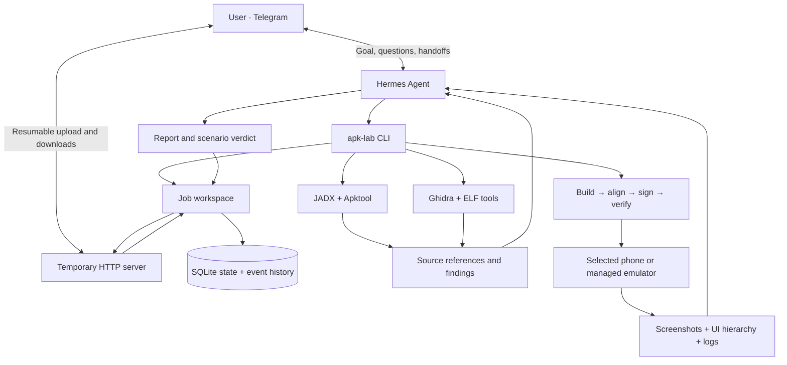

# Architecture

Hermes provides reasoning and multimodal interpretation. The Python controller
provides persistent jobs, tool execution, artifact checks and explicit device
ownership. Model conclusions remain accountable to recorded evidence.



## Components

| Module | Responsibility |
| --- | --- |
| core.py | Config, SQLite state, file boundaries, locks, artifact publication |
| server.py + web.html | Authenticated chunked transfer, downloads, idle shutdown |
| pipeline.py | Original integrity, decompile/build/sign, installation receipts |
| research.py | Manifest reconnaissance and exact smali references |
| native.py + Ghidra script | ELF inventory and bounded native decompilation |
| device.py + emulator.py | ADB observation/actions and managed AVD lifecycle |
| collaborative.py | Working mode, turn ownership, observations, scoped memory |
| instrumentation.py | Reversible diagnostic smali markers |
| skill references | Investigation method, language support and evidence interpretation |

## Human handoff

```mermaid
sequenceDiagram
    participant U as User
    participant H as Hermes
    participant C as Controller
    participant A as Android
    H->>C: handoff user + precise next step
    C-->>H: User owns turn; mutations blocked
    U->>A: Navigate to the difficult stage
    U->>H: Ready — continue from here
    H->>C: handoff agent; observe
    C->>A: Screenshot, hierarchy, recent logs
    A-->>H: Current state, without relaunch
    H-->>U: Findings / next handoff
```

## Persistence and verification

Jobs live in `<workspace>/apk-lab/projects/<id>/`: input, decoded, analysis,
evidence, patches, builds, tests, logs and published artifacts. SQLite is authoritative;
state.json is a readable snapshot. Knowledge is scoped to the original APK hash.
Signing keys and server metadata are outside published artifacts.

Original hashes, signed build records and evidence bindings enforce consistency.
A successful build or installation does not establish behavior correctness. A
verified patch needs a passed scenario for its exact hash; explicit no-testing
choice is recorded as untested. Diagnostic builds must be cleaned before final
completion. Static analysis, reconstructed pseudocode and model interpretations
have the coverage limits documented in the skill.

## Experiments

`experiments.py` builds on the existing job operation lock, process-group command
runner, original input integrity check, atomic JSON and event journal. Specs,
per-case requests/responses and incremental reports live in `analysis/experiments`;
command logs remain in `logs`. No new database or verdict system is introduced.
Failures preserve partial coverage; comparison does not upgrade job verification.
`capabilities.py` discovers the isolated optional interpreter. `native_probe.py`
runs outside the controller so native emulator failures cannot crash its Python
process. Research scripts remain job artifacts, not project-specific solutions.
